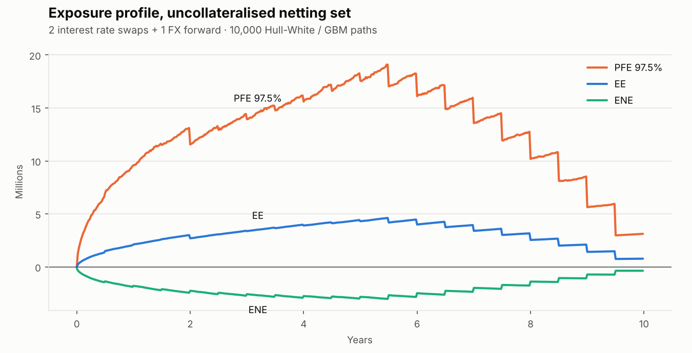
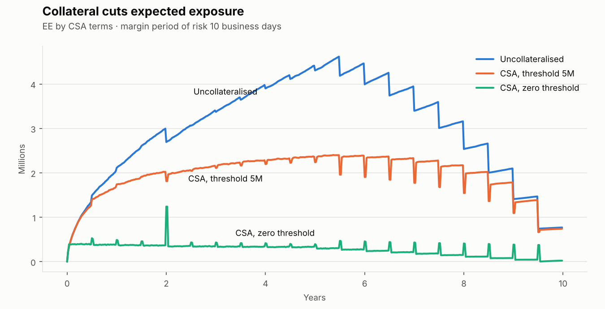

# Counterparty Credit Risk Engine

[](https://github.com/IgnacioMendozaRojas/counterparty-credit-risk/actions/workflows/ci.yml)


A Monte Carlo engine that answers the two questions a counterparty risk desk asks about
every OTC derivatives portfolio:

1. **How much could this counterparty owe us in the future?** Exposure profiles: EE, PFE,
   EPE and the Basel EEPE, per netting set, with or without collateral.
2. **What is that risk worth today?** CVA and DVA, plus their sensitivity to credit spreads.

It is written from public theory (Gregory; Brigo & Mercurio; Basel CRE53) to mirror the
kind of PFE and CVA models used in bank risk teams, with every pricing component checked
against a closed-form result.

<picture>
  <source media="(prefers-color-scheme: dark)" srcset="docs/exposure_profile_dark.png">
  
</picture>

## What's inside

| Component | Implementation |
|---|---|
| **Interest rates** | One-factor Hull-White fitted exactly to the initial zero curve; exact Gaussian transitions (no discretisation bias in the short rate); closed-form zero-coupon bonds for fast revaluation |
| **FX** | GBM under the domestic measure, drift driven by the *simulated* domestic short rate, correlated with the rate factor |
| **Numeraire** | Pathwise bank account, so discounted exposures use stochastic discounting |
| **Instruments** | Fixed-float interest rate swaps (payer/receiver, forward-starting, pathwise floating fixings) and FX forwards |
| **Netting & collateral** | Netting sets; CSA with thresholds, minimum transfer amount, initial margin and a margin period of risk |
| **Exposure** | EE, ENE, PFE at any quantile, EPE, effective EE and EEPE (Basel IMM definition) |
| **Valuation adjustments** | Unilateral CVA and DVA from CDS-implied hazard rates; CS01 |
| **Variance reduction** | Antithetic variates; common random numbers for sensitivities |

## Example: one counterparty, three CSAs

A netting set with a 10y payer swap (100M, at par), a 5y receiver swap (60M) and a 2y FX
forward (buy 20M foreign). Counterparty CDS 150bp, own CDS 80bp, recovery 40%.
10,000 paths on a weekly grid. Run it with `python examples/portfolio.py`.

| Netting set | EPE (1y) | EEPE (1y) | Peak PFE 97.5% | CVA | DVA | CS01 |
|---|---:|---:|---:|---:|---:|---:|
| Uncollateralised | 1.34M | 1.34M | 19.09M | 316k | 141k | 1.9k |
| CSA, threshold 5M | 1.21M | 1.21M | 7.80M | 208k | 91k | 1.2k |
| CSA, zero threshold | 0.39M | 0.46M | 5.70M | 33k | 18k | 0.2k |

Netting the three trades cuts CVA by **26%** compared with booking them standalone.

<picture>
  <source media="(prefers-color-scheme: dark)" srcset="docs/collateral_effect_dark.png">
  
</picture>

**Reading the chart.** The saw-tooth in every profile is the swaps paying coupons:
exposure drops each time a cash flow settles. Under a zero-threshold CSA the residual
exposure is only what the portfolio can move during the 10-day margin period of risk, but
it *spikes* on payment dates, most visibly when the FX forward settles at year 2. The
trade's value leaves the netting set while collateral still reflects the value observed
10 days earlier. These spikes are a real feature of collateralised exposure, not noise
(Andersen, Pykhtin & Sokol, 2017).

## Methodology

**Short rate.** $dr = [\theta(t) - a\,r]\,dt + \sigma\,dW_1$, simulated as
$r(t) = x(t) + \alpha(t)$ with $x$ an Ornstein-Uhlenbeck process and $\alpha$ chosen so
that model discount factors match the market curve. Bonds are revalued on every path with

$$P(t,T) = \frac{P^M(0,T)}{P^M(0,t)}\exp\Big\{\tfrac12\big[V(t,T) - V(0,T) + V(0,t)\big] - B(t,T)\,x(t)\Big\}$$

**Exposure.** For netted value $V$ and collateral $C$:
$E(t) = \max(V(t) - C(t), 0)$, with $C(t)$ based on $V(t - \text{MPR})$ net of thresholds.

**CVA.** Assuming independence between exposure and default (no wrong-way risk):

$$\text{CVA} = (1-R)\sum_i \mathbb{E}\big[D(0,t_i)\,E(t_i)\big]\;\big[S(t_{i-1}) - S(t_i)\big],\qquad S(t) = e^{-\lambda t},\ \lambda = \frac{s}{1-R}$$

## Validation

The test suite (33 tests, run on every push) checks the engine against exact results,
not just against itself:

- Simulated discount factors reproduce the input curve, and discounted bonds are
  martingales (error < 0.1%).
- The short-rate state has the exact Hull-White variance.
- A par swap is worth zero; $\mathbb{E}[D(0,t)V(t)]$ equals the analytic PV of the cash
  flows still to be paid, for payer and receiver swaps at several dates.
- The discounted FX rate is a martingale, and the expected exposure of an FX forward
  matches the **Black formula** within 2%.
- Netting never increases exposure; collateral and tighter CSA terms reduce it.
- CVA matches the closed form for a constant exposure profile.

## Usage

```python
from ccr import (
    CSA,
    CreditCurve,
    FXForward,
    FXModel,
    HullWhite,
    InterestRateSwap,
    NettingSet,
    ZeroCurve,
    cva,
    exposure_profile,
    simulate,
)

curve = ZeroCurve((1, 5, 10), (0.032, 0.036, 0.038))
sim = simulate(
    HullWhite(curve, a=0.03, sigma=0.01),
    horizon=10,
    fx=FXModel(spot=1.10, vol=0.10, foreign_rate=0.02),
    n_paths=10_000,
)

trades = [
    InterestRateSwap(100e6, InterestRateSwap.par_rate(curve, 10), 10),
    FXForward(20e6, strike=1.12, maturity=2),
]
profile = exposure_profile(NettingSet(trades, CSA(threshold_cpty=5e6)).exposure_values(sim), sim)

print(profile.summary())
print(cva(profile, CreditCurve(spread_bp=150)))
```

```bash
pip install -e ".[dev]"
pytest
python examples/portfolio.py
```

## Limitations and next steps

- Single-curve rates and a one-factor model: no basis spreads, limited decorrelation
  across the curve.
- CVA assumes independence between exposure and default; wrong-way risk is not modelled.
- Flat hazard rate from one CDS spread; a bootstrapped credit curve is a natural extension.
- Planned: Basel **SA-CCR** EAD for comparison with the internal-model EEPE, and
  American Monte Carlo for path-dependent products.

## References

- Gregory, J. (2020). *The xVA Challenge: Counterparty Risk, Funding, Collateral, Capital
  and Initial Margin*, 4th ed. Wiley.
- Brigo, D. & Mercurio, F. (2006). *Interest Rate Models: Theory and Practice*, 2nd ed.
  Springer.
- Andersen, L., Pykhtin, M. & Sokol, A. (2017). Rethinking the margin period of risk.
  *Journal of Credit Risk*, 13(1).
- Basel Committee on Banking Supervision. *CRE53: Internal models method for
  counterparty credit risk*.

## License

[MIT](LICENSE). All market data and trades in the examples are illustrative.
