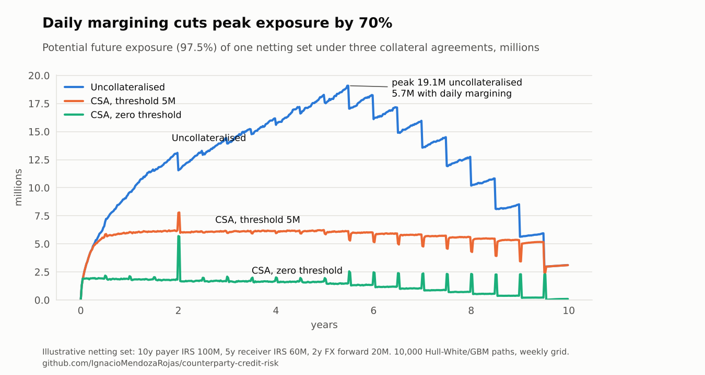
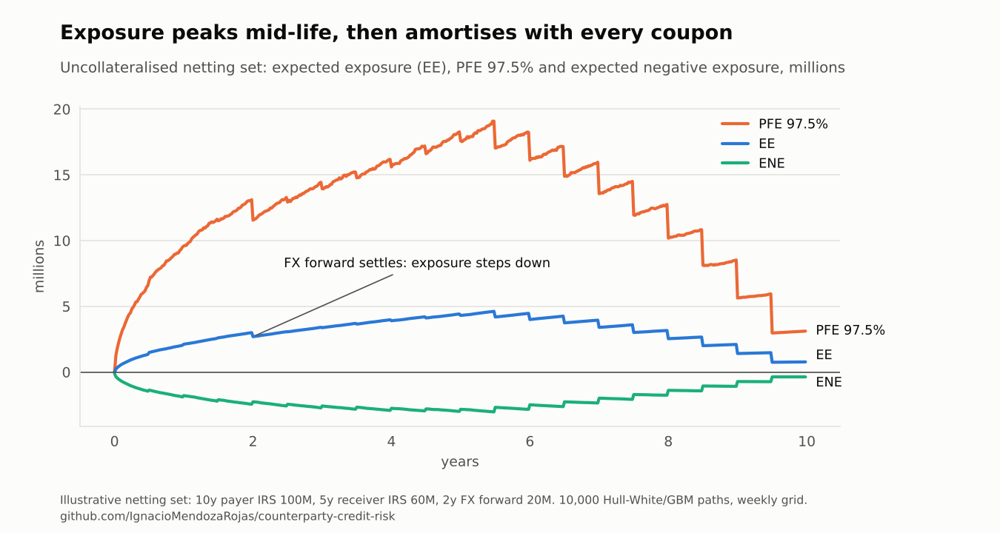
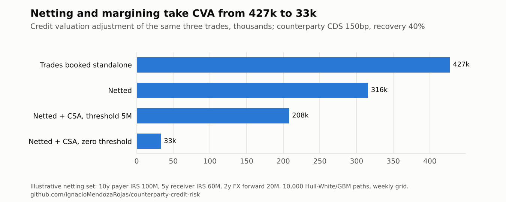

# Counterparty Credit Risk Engine

[](https://github.com/IgnacioMendozaRojas/counterparty-credit-risk/actions/workflows/ci.yml)


**Counterparty credit risk and derivatives.** A Monte Carlo engine that measures how much a derivatives counterparty could owe in the future (EE, PFE, Basel EEPE) and what that risk is worth today (CVA, DVA), with netting and collateral.

> At Banco Ripley I build the stochastic PFE models behind counterparty limits and run CVA/DVA sensitivity analysis. This repository rebuilds that kind of model from public theory (Gregory; Brigo & Mercurio; Basel CRE53), with every pricing component checked against a closed-form result. No bank code, data or parameters; the example portfolio is illustrative.

## Results

On one netting set (a 10-year payer swap of 100M, a 5-year receiver swap of 60M and a 2-year FX forward of 20M; counterparty CDS 150bp):

- **Daily margining cuts peak PFE by 70%**, from 19.1M to 5.7M. A 5M threshold already takes it to 7.8M.
- **Netting the three trades cuts CVA by 26%** against booking them standalone (427k to 316k); a zero-threshold CSA takes it to 33k.
- **Collateralised exposure spikes on payment dates**, because a settling trade leaves the netting set while collateral still reflects its value ten days earlier. The engine reproduces this known effect instead of smoothing it away.

<picture>
  <source media="(prefers-color-scheme: dark)" srcset="docs/pfe-by-csa-dark.png">
  
</picture>

## What this shows

| Task in a counterparty risk team | Where it is done here |
|---|---|
| Set or check a counterparty limit | PFE at any quantile per netting set, over the life of the trades ([`exposure.py`](src/ccr/exposure.py)) |
| Price the credit risk of a new trade | CVA and DVA from CDS-implied hazard rates, and the netting benefit of adding the trade ([`cva.py`](src/ccr/cva.py)) |
| Negotiate collateral terms (CSA) | Thresholds, minimum transfer amount, initial margin and margin period of risk ([`collateral.py`](src/ccr/collateral.py)) |
| Regulatory exposure | Effective EE and EEPE under the Basel internal models method |
| Explain a number to a committee | Every component validated against closed forms; results reproduced by one script |

## Results in detail

Run with `python examples/portfolio.py` (10,000 paths on a weekly grid).

| Netting set | EPE (1y) | EEPE (1y) | Peak PFE 97.5% | CVA | DVA | CS01 |
|---|---:|---:|---:|---:|---:|---:|
| Uncollateralised | 1.34M | 1.34M | 19.09M | 316k | 141k | 1.9k |
| CSA, threshold 5M | 1.21M | 1.21M | 7.80M | 208k | 91k | 1.2k |
| CSA, zero threshold | 0.39M | 0.46M | 5.70M | 33k | 18k | 0.2k |

<picture>
  <source media="(prefers-color-scheme: dark)" srcset="docs/exposure-profile-dark.png">
  
</picture>

**Reading the chart.** The saw-tooth in every profile is the swaps paying coupons:
exposure drops each time a cash flow settles. Under a zero-threshold CSA the residual
exposure is only what the portfolio can move during the 10-day margin period of risk, but
it *spikes* on payment dates, most visibly when the FX forward settles at year 2. The
trade's value leaves the netting set while collateral still reflects the value observed
10 days earlier. These spikes are a real feature of collateralised exposure, not noise
(Andersen, Pykhtin & Sokol, 2017).

<picture>
  <source media="(prefers-color-scheme: dark)" srcset="docs/cva-by-decision-dark.png">
  
</picture>

## How it works

| Component | Implementation |
|---|---|
| **Interest rates** | One-factor Hull-White fitted exactly to the initial zero curve; exact Gaussian transitions (no discretisation bias in the short rate); closed-form zero-coupon bonds for fast revaluation |
| **FX** | GBM under the domestic measure, drift driven by the *simulated* domestic short rate, correlated with the rate factor |
| **Numeraire** | Pathwise bank account, so discounted exposures use stochastic discounting |
| **Instruments** | Fixed-float interest rate swaps (payer/receiver, forward-starting, pathwise floating fixings) and FX forwards |
| **Netting & collateral** | Netting sets; CSA with thresholds, minimum transfer amount, initial margin and a margin period of risk |
| **Exposure** | EE, ENE, PFE at any quantile, EPE, effective EE and EEPE (Basel IMM definition) |
| **Valuation adjustments** | Unilateral CVA and DVA from CDS-implied hazard rates; CS01 |
| **Variance reduction** | Antithetic variates; common random numbers for sensitivities |


### Methodology

**Short rate.** $dr = [\theta(t) - a\,r]\,dt + \sigma\,dW_1$, simulated as
$r(t) = x(t) + \alpha(t)$ with $x$ an Ornstein-Uhlenbeck process and $\alpha$ chosen so
that model discount factors match the market curve. Bonds are revalued on every path with

$$P(t,T) = \frac{P^M(0,T)}{P^M(0,t)}\exp\Big\{\tfrac12\big[V(t,T) - V(0,T) + V(0,t)\big] - B(t,T)\,x(t)\Big\}$$

**Exposure.** For netted value $V$ and collateral $C$:
$E(t) = \max(V(t) - C(t), 0)$, with $C(t)$ based on $V(t - \text{MPR})$ net of thresholds.

**CVA.** Assuming independence between exposure and default (no wrong-way risk):

$$\text{CVA} = (1-R)\sum_i \mathbb{E}\big[D(0,t_i)\,E(t_i)\big]\;\big[S(t_{i-1}) - S(t_i)\big],\qquad S(t) = e^{-\lambda t},\ \lambda = \frac{s}{1-R}$$


## Validation

The test suite (33 tests, run on every push) checks the engine against exact results,
not just against itself:

- Simulated discount factors reproduce the input curve, and discounted bonds are
  martingales (error < 0.1%).
- The short-rate state has the exact Hull-White variance.
- A par swap is worth zero; $\mathbb{E}[D(0,t)V(t)]$ equals the analytic PV of the cash
  flows still to be paid, for payer and receiver swaps at several dates.
- The discounted FX rate is a martingale, and the expected exposure of an FX forward
  matches the **Black formula** within 2%.
- Netting never increases exposure; collateral and tighter CSA terms reduce it.
- CVA matches the closed form for a constant exposure profile.


## Run it

```python
from ccr import (
    CSA,
    CreditCurve,
    FXForward,
    FXModel,
    HullWhite,
    InterestRateSwap,
    NettingSet,
    ZeroCurve,
    cva,
    exposure_profile,
    simulate,
)

curve = ZeroCurve((1, 5, 10), (0.032, 0.036, 0.038))
sim = simulate(
    HullWhite(curve, a=0.03, sigma=0.01),
    horizon=10,
    fx=FXModel(spot=1.10, vol=0.10, foreign_rate=0.02),
    n_paths=10_000,
)

trades = [
    InterestRateSwap(100e6, InterestRateSwap.par_rate(curve, 10), 10),
    FXForward(20e6, strike=1.12, maturity=2),
]
profile = exposure_profile(NettingSet(trades, CSA(threshold_cpty=5e6)).exposure_values(sim), sim)

print(profile.summary())
print(cva(profile, CreditCurve(spread_bp=150)))
```

```bash
pip install -e ".[dev]"
pytest
python examples/portfolio.py
```


## Limitations and next steps

- Single-curve rates and a one-factor model: no basis spreads, limited decorrelation
  across the curve.
- CVA assumes independence between exposure and default; wrong-way risk is not modelled.
- Flat hazard rate from one CDS spread; a bootstrapped credit curve is a natural extension.
- Planned: Basel **SA-CCR** EAD for comparison with the internal-model EEPE, and
  American Monte Carlo for path-dependent products.

## References

- Gregory, J. (2020). *The xVA Challenge: Counterparty Risk, Funding, Collateral, Capital
  and Initial Margin*, 4th ed. Wiley.
- Brigo, D. & Mercurio, F. (2006). *Interest Rate Models: Theory and Practice*, 2nd ed.
  Springer.
- Andersen, L., Pykhtin, M. & Sokol, A. (2017). Rethinking the margin period of risk.
  *Journal of Credit Risk*, 13(1).
- Basel Committee on Banking Supervision. *CRE53: Internal models method for
  counterparty credit risk*.

## License

[MIT](LICENSE). All market data and trades in the examples are illustrative.
